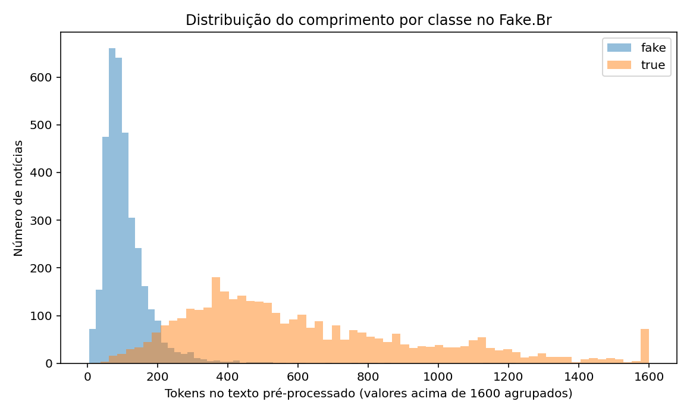

# Fake News Detection in Portuguese — SenticNet & Dataset Bias

Análise reprodutível de **classificação de notícias em português**, derivada de um Trabalho de Conclusão de Curso (TCC). O projeto explora características emocionais extraídas com SenticNet, modelos de aprendizado de máquina e o **efeito do comprimento das notícias** sobre as métricas no Fake.Br Corpus.

> **Resultado central:** ao controlar os atributos avaliados, um modelo baseado somente no comprimento das notícias alcançou F1 = **0,9386**, enquanto emoções normalizadas isoladas obtiveram **0,6075**; a combinação de emoções e comprimento alcançou **0,9401**. Logo, o F1 elevado no corpus **não pode ser atribuído apenas às emoções**. Esses resultados não demonstram detecção de desinformação confiável fora desse conjunto de dados.

## Resultados reproduzidos na versão revisada

Validação cruzada aninhada com **5 folds externos**, **3 internos**, mesma divisão externa para todos os conjuntos de atributos, Regressão Logística e grade de hiperparâmetros reduzida (`--fast`):

| Atributos | F1 médio ± desvio-padrão | Acurácia | ROC AUC |
| --- | ---: | ---: | ---: |
| Apenas comprimento do texto | 0,9386 ± 0,0066 | 0,9374 | 0,9804 |
| Apenas emoções normalizadas | 0,6075 ± 0,0132 | 0,6094 | 0,6399 |
| **Emoções + comprimento** | **0,9401 ± 0,0058** | **0,9389** | **0,9807** |
| Apenas médias emocionais | 0,5460 ± 0,0055 | 0,5490 | 0,5680 |

O ganho médio pareado da combinação sobre comprimento foi de apenas **+0,0014 F1**, com variação entre os folds. Não há evidência suficiente para afirmar que a melhora seja consistente. As notícias falsas apresentaram mediana de **92 tokens** e as verdadeiras de **523 tokens** após pré-processamento. Isso aponta para um possível viés estrutural do corpus.



- [Relatório de ablação](results/ABLATION.md)
- [Resumo agregado versionado em JSON](results/published_summary.json)
- [Notebook executado com gráficos e tabelas](notebooks/04_published_results.ipynb) — abre diretamente no GitHub, sem precisar baixar o corpus.

**Resultados históricos do TCC** (metodologia original; não são comparáveis diretamente ao protocolo de validação aninhada): Regressão Logística F1 93,84% e ROC AUC 0,9774; Random Forest F1 93,56% e ROC AUC 0,9767. No código antigo existia uma divergência entre `total_palavras` e `total_palavras_encontradas`. A refatoração explicita as duas variáveis e não afirma ter reproduzido exatamente o pipeline histórico.

## Como executar

Requer **Python 3.10+**. Na raiz do projeto:

```powershell
python -m venv .venv
.\.venv\Scripts\Activate.ps1
python -m pip install -e ".[dev,notebooks]"
python -m pytest -q
```

O corpus Fake.Br e o léxico SenticNet **não estão incluídos**, nem em artefatos derivados com textos de notícias.

1. Obtenha o corpus no [repositório oficial Fake.Br](https://github.com/roneysco/Fake.br-Corpus) e confira sua documentação/citação.
2. Para repetir as avaliações feitas aqui, coloque **seu CSV já enriquecido** em `data/analise_emocional_completa.csv`, com as colunas exigidas pelo pré-processamento (`preprocessed_news`, `label`, médias e contagens emocionais). **O CSV enriquecido não é fornecido neste repositório.**
3. Execute:

```powershell
python scripts/compare_normalizations.py --fast --n-jobs 2
python scripts/validate_models.py --cv 5 --inner-cv 3 --fast --n-jobs 2
python scripts/analyze_bias.py --cv 5 --inner-cv 3 --fast --n-jobs 2
```

Isso gera saídas locais em `results/` ignoradas pelo Git, incluindo `ablation_validation.json` e `ABLATION_REPORT.md`. O arquivo `results/published_summary.json` é uma **fotografia agregada** da execução de referência, e não é sobrescrito pelos comandos acima.

Se você tiver apenas o CSV original do Fake.Br, a etapa anterior é extrair os atributos usando o SenticNet. Consulte o [site do SenticNet](https://sentic.net/) para obter acesso autorizado ao léxico e verificar os respectivos termos. Coloque o arquivo compatível em `data/senticnet_data.py` e execute:

```powershell
python scripts/extract_features.py --input data/pre-processed.csv --senticnet data/senticnet_data.py
```

A interface de dicionário (`senticnet`) usada nessa etapa deriva do código do TCC; **a compatibilidade com versões atuais do fornecedor não foi verificada**. Se usar um léxico diferente, os resultados podem mudar.

### Notebooks

- [`01_emotional_analysis.ipynb`](notebooks/01_emotional_analysis.ipynb), [`02_model_experiments.ipynb`](notebooks/02_model_experiments.ipynb) e [`03_integrated_analysis.ipynb`](notebooks/03_integrated_analysis.ipynb): **notebooks históricos**, mantidos sem saídas executadas. Dependem do CSV local e não substituem a validação principal.
- [`04_published_results.ipynb`](notebooks/04_published_results.ipynb): **notebook executado e seguro para publicação**; lê só `results/published_summary.json`, contém gráficos e tabelas agregadas, sem textos de notícias. Para refazê-lo, instale as dependências `notebooks` e execute a partir da raiz:

```powershell
jupyter lab
```

No JupyterLab, abra `notebooks/04_published_results.ipynb` e clique em **Run All**. A configuração do notebook resolve o diretório do projeto mesmo quando aberto a partir de `notebooks/`.

## Organização

```text
src/fake_news_detection/  # construção de atributos, seleção e validação
scripts/                  # pipelines CLI de extração, treino e experimentos
notebooks/                # notebooks originais + apresentação executada
results/                  # relatórios, figuras e resumo agregado publicado
tests/                    # testes automatizados
data/                     # dados locais: ignorados no Git
```

## Limitações e ética da interpretação

- A diferença de comprimento entre classes pode refletir o processo de coleta/curadoria. O comprimento não é prova de veracidade.
- Razões emocionais ainda podem incorporar informação sobre comprimento; o estudo de ablação **não identifica efeitos causais**.
- Os folds evitam separar duplicatas de textos **exatamente iguais**; documentos semelhantes e relacionados não foram auditados.
- A avaliação é interna ao Fake.Br, sem conjunto externo independente de outra fonte/período.
- Desvios-padrão entre folds **não são intervalos de confiança**.
- O objetivo é analisar propriedades do corpus e do pipeline de ML, **não fornecer uma ferramenta de checagem factual pronta para produção**.

## Créditos, dados e licença

- Corpus: [Fake.Br Corpus](https://github.com/roneysco/Fake.br-Corpus) — cite os autores e consulte os termos da fonte.
- Léxico: [SenticNet](https://sentic.net/) — sujeito aos termos de uso do responsável; não incluído.
- Código e organização: trabalho acadêmico do autor e refatoração para portfólio. Os notebooks históricos foram preservados como material de referência.
- O **código próprio** neste repositório está disponibilizado sob a [licença MIT](LICENSE), **sujeita à confirmação do titular antes de publicar**. Essa licença não cobre os recursos de terceiros.

## Desenvolvimento

```powershell
python -m pytest -q
```

Antes da primeira publicação: confirme a titularidade e a atribuição no arquivo `LICENSE`, revise os arquivos com `git status`, e não versione os CSVs do corpus nem o dicionário SenticNet.
